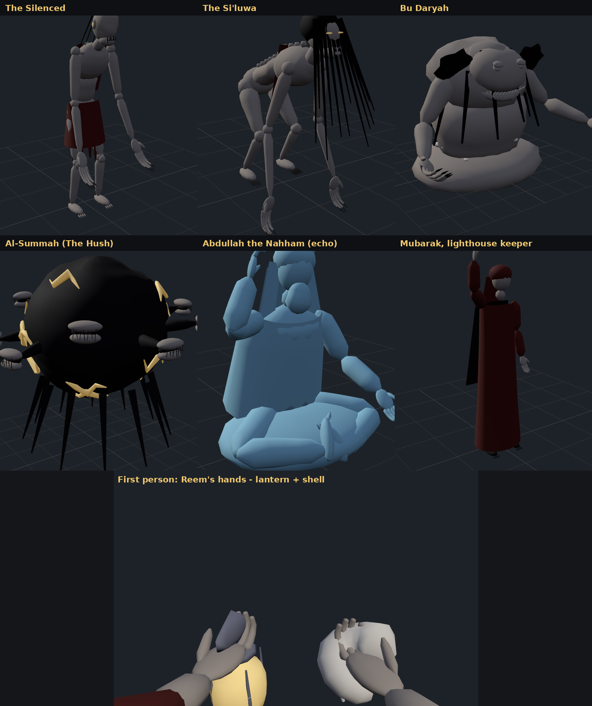

# الصمّة — AL-SUMMAH
### وثيقة تصميم اللعبة (الشخصيات، العالم، المخلوقات، الأسلحة، المستوى)

> مكمّلة لـ `VOICE_HORROR_SPEC.md` (المواصفة التقنية). كل اسم/رقم هنا موجود فعلاً في الكود أو في ملفات الإعداد.
> **الشعار:** «صوتك سلاحك… وصوتك يكشفك»

---

## 0. إجابات مقترحة للأسئلة المفتوحة (القسم 10 في المواصفة)

| # | السؤال | الاقتراح المنفّذ | ليش |
|---|---|---|---|
| 1 | اسم اللعبة | **الصمّة (AL-SUMMAH)** — اسم الجزيرة، من «الصمت» | كلمة وحدة، عربية، فيها الفكرة كلها. والوحش الأخير اسمه نفس الاسم. |
| 2 | الدردشة الصوتية للجماعي | **مؤجَّل لـ M5** (المواصفة تمنع بناءه قبل). | ما انلمس. |
| 3 | تعرّف الكلمات للعبارات | **MFCC-DTW فقط في النسخة الأولى** | بدون أي package، ويشتغل بأي لغة/لهجة. حسّنّاه بنافذة 25 ms وأرضية mel نسبية (القسم 6 تحت). |
| 4 | عدد الأسلحة وطولها | **3 أسلحة**: قصير (عبارة 0.5–2.5 ث)، متوسط (لحن 1.5–4.5 ث)، طويل (لحن 4–9 ث) | يغطي النوعين (Melody/Phrase) ويحقق مبدأ «الأقوى أطول وأخطر». |
| 5 | ضرر جزئي أو حد صارم؟ | **الاثنين:** حد أدنى صارم (`minScoreToFire`) ثم ضرر جزئي متصاعد | تحت الحد = صفر (لكن الصوت انحسب). من الحد لـ70 = 40%→100%. من 70 لـ100 = 100%→150%. |
| 6 | الثيم والمكان | **جزيرة غوص خليجية مهجورة، 1979** — فريج، بيت النهّام، سوق، بير، رصيف، لنج، منارة | الغناء جزء أصيل من تراث الغوص (النهّام كان يغني للبحّارة). الفكرة كلها تقعد على أرض حقيقية. |

---

## 1. الرؤية

لعبة رعب منظور أول قصيرة ومكثّفة. اللاعب يدخل جزيرة سكتت فجأة، والمخلوقات اللي فيها **عمياء وتسمع بس**. السلاح الوحيد هو **صوت اللاعب نفسه** — أغاني وعبارات سجّلها هو بصوته الهادي، ولازم يعيدها وهو خايف.

**الإحساس المطلوب:** أنفاس محبوسة، همس، ثم لحظة غناء يائسة وأنت عارف إن الجزيرة كلها سمعتك.

### الأعمدة كيف تحققت
1. **الصوت سلاح وخطر بنفس اللحظة:** أثناء الأداء ما فيه أي استثناء — `PlayerNoiseEmitter` يرسل صوتك للمخلوقات كل فريم، سواء كنت تغني لسلاح أو تتكلم.
2. **السلوك الفعلي:** كل شي من الميكروفون الحقيقي. ما فيه زر «اصرخ».
3. **العدل الصوتي:** التقييم على منحنى النغمة النسبي (بعد طرح الوسيط) والإيقاع — الصوت الغليظ والرفيع ياخذون نفس الدرجة (اختبار `LowVoiceAndHighVoice_SameContour_ScoreAlike`).
4. **الخوف جزء من الآلية:** التسامح في DTW مضبوط بحيث الأداء المتوتر (أسرع 20٪، طبقة أعلى، صوت أخفض) يخسر أقل من 10 نقاط.

---

## 2. العالم والقصة

### جزيرة الصمّة، 1979
جزيرة غوص صغيرة في الخليج. فريج من بيوت الحجر البحري، سوق صغير حول بير، رصيف خشب يمتد للبحر، ومنارة على صخرة بعيدة.

**ليلة السكتة:** قبل أربعين ليلة، سكتت الجزيرة كلها في ليلة وحدة. آخر بث طلع من المنارة كان صوت النهّام عبدالله يغني… ثم انقطع. اللي بقوا صاروا **مساكيت**: عميان، أفواههم مخيّطة، يمشون على صوت أي نفَس — لأن الصوت هو الشي الوحيد اللي ما عاد عندهم.

**الحقيقة (تنكشف تدريجياً في الأشرطة والنهاية):** مبارك، حارس المنارة، كان مهووس بحفظ أصوات الجزيرة على أشرطة — «لو حفظنا أصوات الجزيرة ما تموت أبد». حفظها أكثر من اللازم: سجّل الأصوات من أصحابها. الصمّة هي الكتلة اللي تجمّعت فيها الأصوات المسروقة. وآخر بث — «صوت الجد» — كان مبارك يشغّل تسجيل.

### البناء الدرامي (الشريحة العمودية ~10 دقايق)
| الفصل | المكان | ما يتعلمه اللاعب | الشخصية اللي تتكلم |
|---|---|---|---|
| 1. الوصول | المرسى | الصوت يكشفك؛ الهمس آمن تقريباً | مبارك (راديو) + شريط 1 |
| 2. الفريج | السكيك | المخلوق يروح لآخر مكان سمعك فيه؛ الدولاب | مبارك + شريط 2 |
| 3. البيت | بيت النهّام (آمن) | سلاح جديد = تسجيل جديد؛ العبارة | شريط 3 |
| 4. السوق | السوق والبير | الحارس اللي ينادي الكل؛ المخلوق السريع | مبارك + شريط 4، 5 |
| 5. اللنج | الرصيف واللنج | أقوى سلاح = أعلى خطر | مبارك + شريط 6 |
| النهاية | — | انكسار الصمّة + الاعتراف | مبارك |

---

## 3. الشخصيات

### ريم — اللاعب
- **العمر:** 27. أرشيفية صوت في إذاعة المدينة. حفيدة آخر نهّام في الجزيرة.
- **ما نشوفها أبداً** (منظور أول) **وما نسمع صوتها إلا صوت اللاعب الحقيقي.** هذا قرار تصميم: صوت ريم = صوتك.
- **دافعها:** آخر بث من المنارة كان جدها يغني. جات تدوّره.
- **أداتها:** فانوس (ضوء اللاعب) وراديو لاسلكي.
- **قوسها:** تبدأ تسمع وتتعلم «وزن الصوت» من أشرطة جدها، وتنتهي وهي تغني بأعلى صوتها عارفة إن الجزيرة كلها بتسمع.

### عبدالله النهّام — الجد (أشرطة)
- **الحضور:** 6 أشرطة كاسيت متفرقة في الجزيرة (`Story.Tapes`).
- **شخصيته:** رجل بحر، هادي، حكيم بدون وعظ، يحب حفيدته. جمله قصيرة.
- **فلسفته (قلب اللعبة):** «الصوت له وزن. النهّام ما يصارخ… يوزن صوته.» — هذي حرفياً الآلية: الدقة أهم من القوة.
- **دوره الميكانيكي:** كل شريط يعلّم شي (الهمس، المساكيت، النَّفَس، السعلوة، مبارك، الطار).
- **مصيره:** غامض في الشريحة. التلميح: صوته واحد من أفواه الصمّة.

### مبارك — حارس المنارة (راديو)
- **الحضور:** رسائل راديو مكتوبة (`RadioView`) أثناء اللعب. ما يظهر جسدياً. المنارة تشوفها من كل الجزيرة وضوءها يدور.
- **شخصيته:** دافئ، مساعد، خايف. يهمس دايماً. يعرف الجزيرة أكثر من اللازم.
- **السر:** هو اللي «حفظ» الأصوات. يساعد ريم لأنه يبي الصمّة تنكسر — وعشان يتخلص من ذنبه.
- **آخر جملة:** «الصوت اللي في آخر بث — مو صوت جدّك. هذا صوتي أنا. أنا اللي سجّلته.» (تفتح الجزء التالي.)
- **سطر خاص:** إذا ارتفع الخطر فوق 70: «ريم، صوتك واصل لين المنارة. اهدي.» — يربط الواجهة بالقصة.

---

## 4. المخلوقات

كلهم **عميان**: يتصرفون على الصوت فقط (`CreatureBrain`). الجدران (`Occluder`) تخفض مدى سمعهم 40٪ لكل جدار.

### المسكوت (The Silenced) — `Creature_Maskut` · Stalker
- **الشكل:** طويل نحيف محني، جلد رمادي باهت، رأس بدون عيون، فم مخيّط بغرز سودا، أذنين تضوي (تشتد لما يطارد). ثياب بالية.
- **الحكاية:** جيرانك. أم ناصر، ولد الخبّاز، سالم بياع الشباك.
- **السلوك:** يتجول ببطء ← يسمع ← يروح **لآخر مكان سمعك فيه** ← إذا استمر يسمعك 0.8 ث يطارد ← إذا سكتّ يدوّر حول المكان 8 ث ← يرجع يتجول. يحس فيك إذا لمسك تقريباً (1.4 م) إلا إذا كنت مختبئ.
- **الأرقام:** صحة 100 · سرعة 1.1 / 2.0 / 3.4 · ضربة 34 · سمع ×1.0.
- **الحركة الإجرائية:** يميل رأسه ويحوّل أذنه للصوت وهو يدوّر.
- **مواجهته:** تكلّم ثم تحرّك. الدولاب. الصدفة توقفه ثانية.

### السعلوة (The Si'luwa) — `Creature_Siluwa` · Hunter
- **الشكل:** منخفضة على أربع تقريباً، أطراف طويلة، شعر أسود طويل يغطي الوجه، شقّين يضوون مكان العيون.
- **الحكاية:** من حكايات العجايز — «وكنا نضحك عليهم».
- **السلوك:** أسرع، تسمع ×1.3، تقرر تطارد بسرعة (0.5 ث)، **تنقز** لما تقرب (6 م، سرعة ×2.2)، وإذا انجرحت جرح كبير ونزلت تحت 35٪ **تهرب** 4 ث وترجع.
- **الأرقام:** صحة 140 · سرعة 1.6 / 3.0 / 4.6 · ضربة 30.
- **مواجهته:** لا تركض قدامها (الركض يصدر صوت 5 م). اضربها بالطار أو الصدفة بدرجة عالية.
- **الظهور:** وحدة في السوق، والمخرج (Director) يستدعي وحدة إضافية إذا الخطر فوق 85.

### بو درياه (Bu Daryah) — `Creature_BuDaryah` · Sentinel
- **الشكل:** جذع ضخم طالع من الأرض عند البير، مغطى بطحالب، رأس عريض بزعانف مكان الأذنين، فك واسع، حلق يضوي أخضر.
- **الحكاية:** كان يسحب البحّارة بندائه. الحين ساكن عند البير.
- **السلوك:** **ما يتحرك.** يسمع ×2 (أبعد من الكل). إذا سمعك: **يصيح** 1.8 ث ← كل مخلوق متحرك داخل 45 م يروح للمكان اللي سمعك فيه. يرتاح 10 ث بين كل صيحة. يضرب إذا قربت منه (2.6 م، ضربة 50).
- **مواجهته:** اعبر السوق بصمت تام، أو اقتله أول (صحة 160) — بس قتله يحتاج غناء… واللي يسمعه هو أول واحد.

### الصمّة (Al-Summah / The Hush) — `Creature_Summah` · Heart (الزعيم)
- **الشكل:** كتلة سودا طافية على سطح اللنج، حولها حلقة تدور من 9 أفواه مخيّطة (كل فم صوت مسروق)، وقلب يضوي أبيض.
- **السلوك:** ما يتحرك. يصيح وينبّه. **يستدعي** مسكوت كل 14 ث (حد أقصى 3) طول ما أنت داخل 35 م. يضرب من 3.4 م.
- **المقاومة:** النَّفَس ×0.2 · الصدفة ×0.5 · **الطار ×1.5** · مقاوم للترنّح (×0.3). صحة 450.
- **الدرس:** «ما تنكسر بكلمة ولا بنغمة قصيرة. تنكسر بأغنية كاملة.» — الطويل هو المفتاح، والطويل هو الأخطر.
- **عند الموت:** كل المخلوقات تتفتت، الخطر يرجع صفر، ورسالة مبارك الأخيرة.

### المخرج (Creature Director)
مو شخصية، لكن له حضور: إذا الخطر ≥ 55 يصحّي مسكوت في نقطة بعيدة (≥18 م) ويرسله لآخر مكان سمعك فيه، كل 25 ث. فوق 85: كل 12 ث، و40٪ احتمال سعلوة. حد أقصى 3.

---

## 5. الأسلحة — ذخائر النهّام

كل سلاح **مربوط بتسجيل اللاعب** (لحن/دندنة أو عبارة، يختار هو). يسجّل مرتين، ولازم التسجيلين يتشابهون ≥ 60.

| | الصدفة | الطار | النَّفَس |
|---|---|---|---|
| **المعرّف** | `w_sadafa` | `w_tar` | `w_nafas` |
| **الحكاية** | صدفة محار كان النهّام يغني فيها للغاصة تحت الماء | طار جلده من جلد الحوت، يضبط إيقاع المجاديف | مو أداة — كلمة. آخر شي علّمه لحفيدته |
| **النوع الافتراضي** | لحن | لحن | عبارة |
| **الطول** | 1.5–4.5 ث | 4–9 ث | 0.5–2.5 ث |
| **الإطلاق** | شعاع 22 م يصيب أول مخلوق، **الجدار يوقفه** | موجة 12 م حولك تصيب الكل (تضعف للنص على الحافة) | مخروط 7 م / 40° قدامك |
| **الضرر الأساسي** | 45 | 110 | 20 |
| **الحد الأدنى** | 35 | 35 | 40 |
| **التبريد** | 5 ث (فشل: النص) | 14 ث | 3 ث |
| **الترنّح** | 1.2 ث | 2.5 ث | 1.8 ث |
| **المستوى (tier)** | 2 | 3 | 1 |
| **متى** | من البداية | من البداية | من الصندوق في بيت الجد |

**التغذية الراجعة:** حجم وسطوع التأثير ولون الضوء يعكسون الدرجة. النجاح = وتر صافي (طبقته ترتفع مع الدرجة). الفشل = عنقود نشاز أحمر. الدرجة تظهر كبيرة وسط الشاشة.

**التوازن (المواصفة 2.6):** الطار 9 ث غناء = ~9 ث من الضجيج = الخطر يقفز ~70–80 نقطة إذا غنيته بصوت كلام عادي = المخرج يبدأ يستدعي. تقدر تغنيه همس — ضرر أقل بس أخفى.

---

## 6. المستوى: جزيرة الصمّة (الشريحة العمودية)

`Tools/VoiceHorror/Build Vertical Slice - Al-Summah Island (M4)` يبنيه كامل.

```
                       [اللنج + الصمّة]  z≈176
                             ║ الرصيف (شريط 6)
  ════════ جدار السوق ═══════╝ بوابة  z=136
  │  السوق: بسطات، دواليب، شريط 4، 5          │
  │        بو درياه ◉ البير                    │   🗼 المنارة (بعيد، يمين)
  │  مسكوت + سعلوة يتجولون                     │
  ════ ║ باب خلفي ═══════════════════════════  z=84
  [بيوت] ║ بيت النهّام (آمن): النَّفَس، شريط 3 ║ [بيوت]
  ════ ║ باب أمامي ═══════════════════════════  z=66
  ──── شارع ── مسكوت ───────── دولاب ─────────  z≈64
  [بيوت] ║زقاق║ [بيوت] ║زقاق║ [بيوت]
  ──── شارع ── مسكوت ── شريط 2 ── دولاب ──────  z≈42
  [بيوت]          ║زقاق║          [بيوت]
                   ║ المرسى (شريط 1)        z≈0   ← تبدأ هنا
```

- **الطريق الوحيد للسوق يمر من بيت الجد** — كل لاعب يمر بالمكان الآمن ويلقى النَّفَس.
- **بيت النهّام:** جدرانه «تبلع كل صوت» (`SafeRoom`): داخله مداك صفر، فتقدر تسجّل سلاح جديد وتتدرب.
- **الإضاءة:** فوانيس دافية ترشد الطريق، تتذبذب أكثر مع الخطر (`FlickerLight`)، والضباب يحمر.
- **نقاط الحفظ:** كل مثير هدف (`ObjectiveTrigger`) يحفظ نقطة. الموت ← «من آخر نقطة» أو «إعادة المستوى».

---

## 7. الاتجاه الفني والصوتي

- **بصري (greybox حالياً):** حجر بحري مرجاني، خشب داكن، أقمشة حمرا باهتة على البسطات. ليل أزرق بارد + فوانيس برتقالية. المخلوقات مبنية من أشكال بسيطة لكن بإيماءات قوية (انحناء، ميلان الرأس، أفواه مخيّطة).
- **ألوان الواجهة:** نص رملي، إطار نحاسي، فيروزي «زجاج البحر» = صوتك، أحمر = الخطر، ذهبي = الدرجة.
- **الصوت (كله مُولَّد بالكود — `ProceduralAudio`):** همهمة منخفضة تعلى وتحتد مع الخطر، دقات قلب فوق 45٪ خطر أو مع الإصابة، موج، أنفاس المخلوقات (3D)، صيحة بو درياه، وتر النجاح ونشاز الفشل، خطوات.
- **الخط:** الواجهة تستخدم خطوط النظام اللي فيها حروف عربية (Tahoma / Geeza Pro…) مع تشكيل الحروف وترتيب RTL يدوي (`ArabicShaper`)، والعربي هو الافتراضي. الإنجليزي من الإعدادات.

---

## 8. خريطة الأنظمة ↔ الكود

| النظام | الملفات |
|---|---|
| الميكروفون | `Audio/MicCapture.cs` (حلقة، قطع 20 ms، انقطاع الجهاز) |
| المعايرة | `Audio/CalibrationRunner.cs`, `UI/CalibrationView.cs`, `VoiceDsp/VoiceLevels.cs` |
| مستويات الصوت | `Audio/VoiceLevelMeter.cs` ← `VoiceLevelModel` (مدى مستمر + attack/release) |
| الضجيج والخطر | `Gameplay/Noise/*` + `Player/PlayerNoiseEmitter.cs` |
| المخلوقات | `Gameplay/Creatures/CreatureBrain.cs` (العقل)، `CreatureBody.cs` (الشكل والحركة)، `CreatureDirector.cs` |
| الأسلحة | `Gameplay/Weapons/WeaponController.cs` (نافذة الأداء → تقييم بخيط منفصل → ضرر) |
| التقييم | `VoiceDsp/*` (C# نقية، `dsp-tests`) |
| القصة | `UI/Story.cs` (الأشرطة، الراديو، الأهداف)، `UI/Loc.cs` (النصوص) |
| التدفق | `Core/GameFlow.cs` (خصوصية ← ميكروفون ← معايرة ← مقدمة ← تسجيل ← لعب ← موت/فوز) |

---

## 8.1 الشخصيات والحركة الإجرائية



| الشخصية | المخطط (`VoiceArt/Blueprints.cs`) | الحركة |
|---|---|---|
| المسكوت | ذو قدمين، 20 عظمة، ضلوع بارزة، فم مخيّط، أصابع طويلة بمخالب، إزار ممزق | مشي بتثبيت الأقدام (IK)، تسمّع بميلان الأذن، مدّ اليدين للأمام وهو يطارد، خدش، ترنّح، جلوس خامد عند الجدار وقيام، سقوط |
| السعلوة | رباعية، عمود فقري بارز، شعر طويل يغطي الوجه (فيزياء)، شقّين يضوون | خطوة قطرية (يد يمين مع رجل يسار)، انحناء في المطاردة، قفزة، هروب |
| بو درياه | جذع ضخم طالع من الأرض، عيون ميتة حليبية، فك بأسنان، زعانف، طحالب | الزعانف تنفتح لما يسمع، رأس يلف للصوت، صيحة يكبر فيها كيس الحلق، ضربة بالذراع |
| الصمّة | كتلة سودا بشقوق مضيئة، حلقة 9 أفواه مخيّطة، مجسّات | الحلقة تدور أسرع مع الهيجان، الأفواه تتمتم **وتنفتح لما يوصلها صوتك**، نبض |
| عبدالله النهّام (صدى) | جالس متربّع، يده خلف أذنه، ثوب وغترة، شفاف | تمايل الغناء، الفك يتبع لحن مقام بيات (صوت مولّد)، يتلاشى إذا قربت |
| مبارك | ثوب وغترة وبشت، فانوس مرفوع | يمشي على شرفة المنارة، يوقف ويومض بالفانوس لما يتكلم في الراديو |
| ريم (يدينها) | أكمام عباية، يدين، فانوس، صدفة، طار | تمايل مع النظر والمشي، رجفة مع الخطر، حركة لكل سلاح أثناء الغناء |

## 9. اللي بعد الشريحة (اقتراحات)

1. **M5 تعاوني** حسب المواصفة القسم 4 (بعد قرار حل الدردشة).
2. **مبارك كفصل ثاني:** المنارة كمستوى؛ مبارك يستخدم أشرطة لصوتك أنت (من الملامح نقدر نولّد دندنة اصطناعية من منحنى النغمة المحفوظ بدون حفظ صوت خام) ليضلل المخلوقات.
3. **تقييم متدفق** (subsequence DTW) للإطلاق المبكر.
4. **أصول فنية حقيقية** تستبدل الأجسام المولّدة: الهيكل والأدوار (`Roles`) والأرجل معرّفة بالأسماء، فتقدر تحط موديل بنفس أسماء العظام وتبقى الحركة والعقل كما هي.
5. **أصوات حقيقية** بدل المولّدة: كل مصدر في `ProceduralAudio` له مكان واحد.
